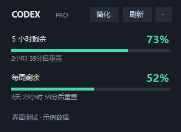
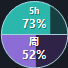

# Codex Float

Windows 原生 Codex 额度悬浮窗，无需安装第三方运行库。需要 Windows 自带的 .NET Framework 4.8，以及已安装并登录的 Codex 桌面版或原生 codex.exe。

## 使用

下载或克隆源码后，运行 `build.cmd` 生成程序，再双击 `CodexFloat.exe`。首次查询通常需要几秒；之后每分钟刷新。

- 点击“简化”缩成 68 像素圆球（随 DPI 缩放），上半圆青绿色表示 5 小时额度，下半圆紫色表示每周额度。填充宽度与数字表示剩余量；缺失窗口显示 `--`。
- 点击圆球展开，拖动圆球移动；右键也可以切换模式。自动记住简化模式，下次启动恢复。
- 拖动窗口空白处移动，自动保存位置。
- 默认置顶。右键窗口或托盘图标，可以切换置顶、调整透明度、立即刷新或退出。
- 右上角减号、Alt+F4 都收起到托盘；双击托盘图标恢复。
- 显示 5 小时和每周的剩余百分比、重置倒计时。账号未提供的窗口显示 `--`。
- 网络或登录失败后保留上次读数并注明刷新失败；鼠标放在状态文字上查看原因。
- 到达重置时间后等待下一次真实查询，不自行把额度改成 100%。

## 数据与隐私

通过本机 `codex app-server` 的 `account/rateLimits/read` 获取数据；只执行初始化和额度读取，不创建对话、不发送模型请求。登录及请求由本机 Codex 处理，本程序不读取 auth.json、浏览器 Cookie 或对话内容，不保存账号身份和额度历史。

位置、置顶和透明度保存在 `%LOCALAPPDATA%\CodexFloat\settings.json`。未设置开机启动。退出后停止查询并关闭本程序创建的 app-server 子进程。

接口说明：https://developers.openai.com/codex/app-server

## 源码与编译

`CodexFloat.cs` 为完整源码，采用 GBK 编码；`build.cmd` 为 Windows 编译脚本。双击脚本即可使用系统的 C# 编译器重新生成 EXE。不依赖 NuGet 包或网络下载。

运行 `test.cmd` 执行 `Tests.cs` 中的 6 项额度解析检查。`CodexFloat.exe --smoke` 为界面示例数据检查；`CodexFloat.exe --probe` 为真实只读额度检查（在程序目录生成 probe.txt，含额度百分比和套餐类型）。正常启动不生成这些检查文件。

本版是为当前机器制作的初版，已验证真实额度查询和程序化界面检查。拖动手感、多屏及不同 DPI 下的显示仍以实际使用为准。
